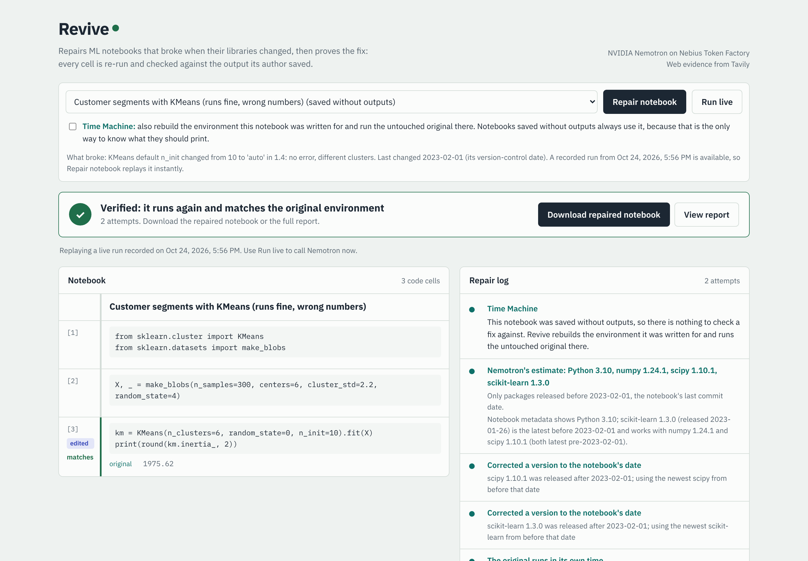
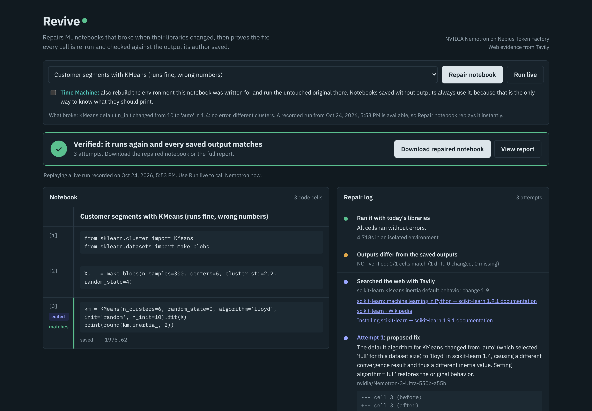

# Revive

**Revive repairs ML notebooks that broke when their libraries changed, then proves the fix:** every cell is re-run and checked against what the notebook printed before it broke. When a notebook was shared without its outputs, Revive's **Time Machine** rebuilds the environment it was written for, runs the untouched original there, and uses that as the reference.

Built for the [Nebius x NVIDIA Global AI Hackathon](https://nebiusglobalaihackathon.devpost.com/) (Coding and Agentic Engineering track) with **NVIDIA Nemotron** models on **Nebius Token Factory** and **Tavily** web search.

- **Live demo:** https://revive-2qgr.onrender.com (free hosting: if it has been idle, the first load can take up to a minute)
- **Demo video:** _(added after upload)_



## The problem

Notebooks are how ML work is shared, and they rot. NumPy 2 removed `np.float` and `np.NaN`, pandas 2 and 3 removed `DataFrame.append`, `.ix` and `fillna(method=...)`, scikit-learn renamed parameters and changed defaults. One recent study found that only 35.1% of ML engineering notebooks it tested were reproducible ([MLEModernizer, 2026](https://arxiv.org/abs/2602.07195)).

Getting an old notebook to *run* again is the easy half. A fix can execute cleanly and still compute something different. Delete the removed `multi_class='ovr'` argument from a `LogisticRegression` and the code runs, but silently switches algorithm. Upgrade past scikit-learn 1.4 and `KMeans` gives worse clusters with no error at all, because its `n_init` default changed. Nothing crashes; the numbers are just wrong.

And many notebooks are shared with outputs cleared, so there is nothing to compare against. A notebook like the KMeans one above runs fine today: every tool that only checks "does it run" calls it working.

## What Revive does

1. **Runs the notebook in an isolated environment** and finds the first cell that fails.
2. **Researches the failure.** Nemotron Nano writes a search query; Tavily finds the changelog, migration guide or issue behind the change. Deprecation warnings the notebook printed in its own era are passed along too: they name what is about to break.
3. **Writes a fix.** Nemotron Ultra reads the code, the error, the library versions and that evidence, and returns a patch: exact snippet replacements in the broken cells and, only when needed, pinned package versions. Patches are checked before anything runs: invalid Python is rejected, and cells that already reproduce their reference output are locked against edits.
4. **Re-runs and repeats** until the notebook runs.
5. **Verifies every cell** against the reference, with a numeric tolerance. If a fix runs but changes the numbers, Revive shows the model exactly what the reference says and what it printed, searches for the behaviour change, and tries again. A notebook is only called **verified** when every reference output matches.

### The Time Machine

The reference is the outputs the author saved. When there are none, Revive recovers them:

1. **Nemotron infers the original environment** from the evidence in the notebook: the Python version in its metadata, warnings it printed, the APIs it calls (for example: `np.float` means NumPy before 1.24, `DataFrame.append` means pandas before 2.0) and, when known, **when it was last changed**. For a notebook in a git repository that date is its last commit; it can also be given with `--written-before`.
2. **uv builds that environment** (an old Python plus exact old library versions) in seconds. With a date, uv only allows packages released before it (`--exclude-newer`), so even libraries Nemotron leaves unpinned resolve to what existed back then.
3. **The untouched original runs there.** If it fails, the error goes back to Nemotron for a better guess.
4. **Its outputs become the reference** the modernised notebook must reproduce.

Why the date matters: some changes leave no trace in the code. The KMeans notebook calls the same API before and after scikit-learn 1.4 changed its default; only the era tells the two apart. In our first benchmark run without dates, Nemotron reasonably chose a recent scikit-learn for it, which already has the new behaviour, so the rebuilt "original" could not expose the change. With the date, it does.

When a notebook does have saved outputs, the Time Machine can also be switched on to check them: the original should reproduce its own saved outputs in the rebuilt environment. Doing exactly that is how we found a mistake in an early version of our own benchmark (see below).

```
broken notebook ──► run in sandbox ──► error? ──► Nemotron Nano: search query ──► Tavily: changelog
       │                  ▲                                                          │
       │                  │                                                          ▼
       │                  └──── check + apply patch ◄──── Nemotron Ultra: patch (replacements, pins)
       │                  │
       │                  ▼ runs
       │        compare every cell with the reference ──► drift? ──► back to Nemotron: reference vs. now
       │                  │ all match
       │                  ▼
       │              VERIFIED  (+ repaired notebook and a JSON report of every attempt and source)
       │
       └─ no saved outputs? ──► Time Machine: Nemotron infers Python + library versions ──► uv builds them
                                ──► untouched original runs there ──► its outputs are the reference
```

Harmless differences are ignored: timings, progress bars, memory addresses, whitespace, warnings on stderr, NumPy 2's `np.float64(0.5)` way of printing `0.5`, and a difference of one unit in the last printed digit of numbers printed with three or more decimals (two numerically equivalent solvers can print `0.182` and `0.181`).

## How NVIDIA Nemotron and Nebius Token Factory are used

| Step | Model (served by Token Factory) | Why this model |
|---|---|---|
| Infer the original environment (Time Machine) | `nvidia/Nemotron-3-Ultra-550b-a55b` | Needs detailed knowledge of when APIs were added, changed and removed |
| Diagnose the failure and write the patch | `nvidia/Nemotron-3-Ultra-550b-a55b` | The hard reasoning step: a library change and its effect on results |
| Write the web search query | `nvidia/NVIDIA-Nemotron-3-Nano-30B-A3B` | A fast, cheap call that runs on every attempt |
| Optional cheaper patching | `nvidia/nemotron-3-super-120b-a12b` | Set `REVIVE_MODEL_DEEP` to it for development; roughly 3x cheaper than Ultra |

- All calls go through Token Factory's OpenAI-compatible API (`https://api.tokenfactory.nebius.com/v1/`).
- **Model IDs are never hard-coded.** Revive lists the available models at startup (`GET /v1/models`) and picks one per role by name, so a renamed or newer Nemotron version does not break it. Any role can be pinned with `REVIVE_MODEL_DEEP`, `REVIVE_MODEL_BALANCED` or `REVIVE_MODEL_FAST`.
- Reasoning output (`<think>...</think>`) is stripped before parsing, temporary server errors (HTTP 429/5xx) are retried without costing an attempt, and token usage is tracked per model, so the benchmark reports exactly what each repair cost.
- Token Factory made it practical to use a 550B-parameter model for the hard steps and a 30B model for the frequent one from the same API, with nothing to host.

## Benchmark

`benchmark/` holds 20 small ML notebooks, each broken against current NumPy 2.5, pandas 3.1 and scikit-learn 1.9. `scripts/make_benchmark.py` builds them reproducibly, and its saved outputs are **authentic**:

1. The old code is executed in a real old environment (Python 3.10 with NumPy 1.22, pandas 1.5 and scikit-learn 1.1, or Python 3.8 with pandas 0.25 for `.ix`). Those outputs, including the deprecation warnings it printed, are saved.
2. A correct modern version must reproduce them today, which proves each notebook can be repaired.
3. The old code must be broken today: it fails, or it runs and prints different numbers.

Three notebooks are also included **saved without outputs**, as people often share them. Only the Time Machine can verify a repair of those. Each comes with the date version control would give it (`as_of` in `benchmark/manifest.json`: 2023-02-01). That date is deliberately not a hint at the exact versions: on it, the newest NumPy had already removed `np.float`, so the Time Machine still has to work the versions out. Because we know their real outputs, the benchmark also reports **faithfulness**: whether the rebuilt original reproduces the author's hidden outputs.

Traps where only output verification can catch the problem:

- `sklearn_kmeans_silent` runs without any error but prints a different inertia today.
- `sklearn_ovr_trap` breaks on a removed argument, and the obvious fix of deleting it runs but changes the accuracy and the predicted probabilities.
- `sklearn_kmeans_silent_no_outputs` is the same silent change with no saved outputs: it "works" unless you rebuild the original environment.

### Results (final run)

| | |
|---|---|
| Verified repairs | **20/20** |
| Notebooks saved without outputs, verified through the Time Machine | **3/3** |
| Time Machine faithfulness: rebuilt original reproduced the author's real (hidden) outputs | **3/3** |
| Fixes that ran but printed different numbers, caught by output verification and then corrected | **3** |
| Average attempts per notebook | 1.35 (max 2) |
| Median time per notebook | 29 s (whole benchmark: about 11.5 minutes) |
| Total tokens, all 20 notebooks | 137,238 |

| Notebook | What broke | Checked against | Outcome | Attempts | Cells matched | Time (s) |
|---|---|---|---|---|---|---|
| numpy_type_aliases | np.float / np.int / np.bool (removed in NumPy 1.24) | saved outputs | verified | 1 | 3/3 | 23.0 |
| numpy2_constants | np.NaN, np.Inf, np.round_ (removed in NumPy 2.0) | saved outputs | verified | 2 | 2/2 | 35.7 |
| numpy2_functions | np.product, np.cumproduct, np.alltrue, np.in1d, np.trapz, np.row_stack | saved outputs | verified | 2 | 3/3 | 48.2 |
| numpy_asscalar | np.asscalar (removed in NumPy 1.23) | saved outputs | verified | 1 | 1/1 | 19.8 |
| pandas_append | DataFrame.append and Series.append (removed in pandas 2.0) | saved outputs | verified | 1 | 2/2 | 24.2 |
| pandas_iteritems | DataFrame.iteritems (removed in pandas 2.0) | saved outputs | verified | 1 | 1/1 | 19.0 |
| pandas_ix_lookup | .ix (removed in pandas 1.0), DataFrame.lookup (removed in 2.0) | saved outputs | verified | 1 | 2/2 | 22.0 |
| pandas_mad_applymap | DataFrame.mad (removed in pandas 2.0), DataFrame.applymap (removed in 3.0) | saved outputs | verified | 1 | 2/2 | 23.0 |
| pandas_io_fill | read_csv(delim_whitespace=...) and fillna(method=...) (removed in pandas 3.0) | saved outputs | verified | 1 | 2/2 | 19.7 |
| pandas_groupby_numeric | groupby().mean() no longer drops non-numeric columns silently | saved outputs | verified | 1 | 1/1 | 25.3 |
| pandas_dates | Series.dt.weekofyear and Series.first (removed in pandas 2.x/3.0) | saved outputs | verified | 2 | 2/2 | 42.7 |
| pandas_dates_no_outputs | Series.dt.weekofyear and Series.first (removed in pandas 2.x/3.0) | rebuilt original | verified | 1 | 2/2 | 41.8 |
| sklearn_encoders | OneHotEncoder(sparse=...) (removed in 1.4), get_feature_names (removed in 1.2) | saved outputs | verified | 2 | 2/2 | 44.3 |
| sklearn_rmse | mean_squared_error(squared=False) (removed in 1.6) | saved outputs | verified | 1 | 1/1 | 30.1 |
| sklearn_renamed_params | base_estimator, algorithm='full', affinity (renamed/removed) | saved outputs | verified | 2 | 3/3 | 49.0 |
| sklearn_ovr_trap | LogisticRegression(multi_class='ovr') removed; deleting the argument silently switches to multinomial | saved outputs | verified | 1 | 1/1 | 28.5 |
| sklearn_kmeans_silent | KMeans default n_init changed from 10 to 'auto' in 1.4: no error, different clusters | saved outputs | verified | 1 | 1/1 | 26.8 |
| sklearn_kmeans_silent_no_outputs | KMeans default n_init changed from 10 to 'auto' in 1.4: no error, different clusters | rebuilt original | verified | 1 | 1/1 | 51.3 |
| legacy_churn_model | DataFrame.append, np.float/np.int, OneHotEncoder(sparse=), iteritems | saved outputs | verified | 2 | 6/6 | 43.7 |
| legacy_churn_model_no_outputs | DataFrame.append, np.float/np.int, OneHotEncoder(sparse=), iteritems | rebuilt original | verified | 1 | 6/6 | 71.1 |

In this run, 3 fixes ran cleanly but printed different numbers; output verification caught each one and the next attempt corrected it (every attempt is listed in `benchmark/results/results.json`). Three examples from an earlier full run, which the screenshot below also shows:

- **sklearn_kmeans_silent** never raised an error. Nemotron's first fix ran but printed a different inertia; the second fix used a removed option; the third restored the old initialisation (`init='random', n_init=10`) and matched.
- **sklearn_kmeans_silent_no_outputs**: the Time Machine rebuilt Python 3.10 with scikit-learn 1.2.1 (it corrected two version guesses Nemotron made that were released after the notebook's date), ran the original, and only then could the drift in today's version be seen and fixed with `n_init=10`.
- **sklearn_encoders**: the first fix ran but printed a NumPy array where the original printed a list; the second added `.tolist()`.



Honest history: on the current benchmark, two earlier full runs verified 17/20 and 19/20 before the Time Machine fixes described above (dated rebuilds; correcting versions released after the date). Before that, a first version of the benchmark, whose expected outputs came from modern rewrites of the old code, verified 17/17, 15/17 and 16/17; running the original code in rebuilt old environments then showed that one of those expected outputs (`sklearn_ovr_trap`) did not exactly match what old scikit-learn printed. That is why the benchmark now uses authentic outputs. The final run above uses all the safeguards added after testing on real notebooks (next section), and the benchmark stayed at 20/20.

Re-run it yourself: `python scripts/run_benchmark.py` (writes `benchmark/results/RESULTS.md`).

### Real notebooks by other authors

A benchmark we wrote ourselves can only show so much, so Revive was also run on four public notebooks that other people wrote years ago: two from Aurélien Géron's *handson-ml* (first edition) and two from Jake VanderPlas's *Python Data Science Handbook* (sources, licences and attribution in [`benchmark/real/`](benchmark/real/README.md)). They are longer and messier than the benchmark, and their saved outputs are the authors' own.

| Notebook | Outcome | Attempts | Cells matched |
|---|---|---|---|
| *Python Data Science Handbook* 3.04, missing values | **verified**: `fillna(method=...)` became `.ffill()` / `.bfill()`; the cell that shows a `TypeError` on purpose still raises it | 1 | 26/26 |
| *Python Data Science Handbook* 3.06, concat and append | **verified**: `df1.append(df2)` became `pd.concat([df1, df2])`, including inside a string the notebook evaluates and prints (the changed label is reported) | 1 | 14/14 |
| *handson-ml* chapter 6, decision trees | **already working**: no change needed; every number matches today, only scikit-learn's printout of the models changed | 0 | 17/17 |
| *handson-ml* chapter 4, linear models | **not repaired**: it breaks in several places (`np.infty`, a negative `tol`, `np.int`, `multi_class`); after the first fix, four attempts in a row pointed at code that was not in the cells, so Revive stopped | 4 | - |

2 of 4 repaired and verified, 1 correctly left alone, 1 honest failure. Final run: 135,262 tokens for all four.

The first run verified 1 of 4, and was more useful than a clean score, because reading the repaired notebooks showed three things to fix:

- **The model tried to fake the check.** pandas now prints `Index([0, 1])` where it used to print `Int64Index([0, 1])`. To make the output match, Nemotron rewrote the code to `str(e).replace("Index(", "Int64Index(")`; elsewhere it overrode `__repr__` to print old scikit-learn output, and re-attached the removed `DataFrame.append` to an object. Revive now rejects patches that paste text from the expected output into the code, add printing hooks, or monkey-patch methods, and tells the model why.
- **Harmless formatting was counted as a difference**, so attempts were spent on noise: `%timeit` timings (the model even pinned old NumPy versions to chase them), matplotlib's `<Figure size 576x288>` lines, `object` vs `str` dtypes, `Int64Index` vs `Index`, and scikit-learn printing only the parameters you set. These are now recognised; numbers are still always compared. (This also fixed an old bug: the rule that hides memory addresses like `0x7f3a…` also matched the `0x400` in `800x400`.)
- **Some cells are meant to fail.** The Handbook shows `vals1.sum()` raising a `TypeError` on purpose, and Revive "repaired" it. A cell whose saved output is an error now has to raise the same exception type, and is otherwise left alone.

Rerunning our own benchmark after these changes surfaced one more weakness: on `sklearn_ovr_trap` Nemotron went in circles, deleting the removed `multi_class='ovr'` argument (the code ran but the numbers changed), then putting it back (crash), then deleting it again. Revive now remembers every version of a cell that crashed or printed different results and rejects a patch that would bring one back, telling the model to find a different approach.

A fourth change came from the longest notebook, which breaks in five separate places: each attempt fixed one and got further, but the fixed budget of attempts ran out. Revive now keeps going while every attempt makes progress (a later failing cell, or more matching cells) and stops after four attempts in a row without progress, or twelve in total.

Run them: `python scripts/run_benchmark.py --set real` (writes `benchmark/real/results/`).

## Quick start

Requirements: Python 3.10+, a [Token Factory API key](https://tokenfactory.nebius.com), optionally a [Tavily API key](https://app.tavily.com). The Time Machine downloads old Python builds and packages, so it needs internet access.

```bash
git clone https://github.com/bhavyasharma2/revive.git && cd revive
python -m venv .venv
source .venv/bin/activate            # Windows: .venv\Scripts\activate
pip install -e ".[dev]"
export NEBIUS_API_KEY=...            # Windows PowerShell: $env:NEBIUS_API_KEY="..."
export TAVILY_API_KEY=...            # optional
python scripts/smoke_test.py         # checks keys, lists Nemotron models, calls each role
```

**Command line**

```bash
python -m revive examples/legacy_churn_model.ipynb
python -m revive benchmark/notebooks/sklearn_kmeans_silent_no_outputs.ipynb    # uses the Time Machine
```

Revive writes `<name>.revived.ipynb` and a JSON report with every attempt, the sources it found, the per-cell verification and, if used, the rebuilt environment. Flags: `--time-machine auto|always|off` (default `auto`: only when there are no saved outputs), `--written-before YYYY-MM-DD` (default: the notebook's last git commit date, if any), `--max-attempts N`, `--timeout SECONDS` (per cell), `--no-search`, `--no-env`, `--rtol`.

**Web app**

```bash
uvicorn revive.web.app:app --port 8000
```

Open http://localhost:8000, pick a notebook and press **Repair notebook**. The notebook view marks each cell as it runs, fails, gets edited and is checked; the repair log shows every rebuild, run, search and patch. Tick **Time Machine** to also rebuild the original environment of a notebook that has saved outputs. Runs recorded by the benchmark replay instantly at no cost; **Run live** calls Nemotron now.

| Setting | Default | Meaning |
|---|---|---|
| `REVIVE_ALLOW_UPLOADS` | `0` (`1` in the Docker image) | Let visitors repair their own notebooks. Uploaded notebooks run code on the server; on a public host, also set `REVIVE_SANDBOX_USER`. |
| `REVIVE_SANDBOX_USER` | unset (`sandbox` in the Docker image) | Run every notebook kernel as this unprivileged user (needs the server to run as root). If it is set but cannot be used, uploads switch themselves off. |
| `REVIVE_KERNEL_STARTUP_TIMEOUT` | `60` (`180` in the Docker image) | Seconds to wait for a kernel to start; slow hosts need more. |
| `REVIVE_LIVE` | `1` | `0` allows recorded replays only. |
| `REVIVE_LIVE_PER_CLIENT` / `REVIVE_LIVE_PER_DAY` | `3` / `20` | Caps on live repairs, to protect API credits. |
| `REVIVE_MAX_CONCURRENT` | `2` | Repairs running at the same time. |

**Tests**

```bash
pytest       # about 280 tests, no API keys needed
```

The tests start real Jupyter kernels, create real isolated environments and (when uv is available) build real old Python environments; the model is replaced by scripted replies. They run on every push through GitHub Actions.

## Deploy

- **Render (free web service):** New → Web Service → connect this GitHub repository; Render detects the Dockerfile. Choose the Free instance type and add `NEBIUS_API_KEY` and `TAVILY_API_KEY` as environment variables. Uploads are on, with sandboxed kernels. The free instance sleeps after 15 minutes without traffic and takes about a minute to wake; it has 512 MB of memory, so recorded replays are the reliable path there, and heavy live runs (especially Time Machine rebuilds) are better run locally.
- **Hugging Face Spaces (Docker Spaces need a PRO account):** `pip install huggingface_hub`, set `HF_TOKEN`, `NEBIUS_API_KEY` and `TAVILY_API_KEY`, then run `python scripts/deploy_huggingface.py --github <repo url>`. Keys are stored as encrypted Space secrets.
- **Any container host, including Nebius Serverless Endpoints:** `docker build -t revive .` then run it with `NEBIUS_API_KEY` and `TAVILY_API_KEY` set; it listens on `$PORT` (default 7860). The image ships with Python 3.8 and 3.10 for the Time Machine.

### Uploaded notebooks and the sandbox

Visitors to the hosted demo can upload their own notebook. Executing a notebook runs its code, and the server's environment holds the Token Factory and Tavily keys, so uploaded code never runs as the server's user. Every kernel (including the Time Machine's) is started through `revive/sandbox.py`, which hands the kernel its connection file and then drops to the unprivileged `sandbox` user with a minimal environment and limits on processes and file sizes. The kernel cannot see the server's environment variables or read them from `/proc` (owned by root), cannot modify Revive's code or the environments it installs packages into, and can only write to its own working folder, which is deleted after the repair. `tests/test_sandbox.py` runs a notebook that tries all of this and checks that it fails; GitHub Actions runs it as root on every push.

## Project layout

| Path | What it is |
|---|---|
| `revive/runner.py` | Executes a notebook in a fresh kernel and reports the exact failing cell, timeouts and crashed kernels |
| `revive/compare.py` | Per-cell output verification with numeric tolerance and normalisation |
| `revive/agent.py` | The repair loop |
| `revive/timemachine.py` | Infers, builds (with uv) and runs the notebook's original environment |
| `revive/patches.py` | The patch format and its checks: strict allowlist for pip requirements, exact unique snippets, syntax check |
| `revive/env.py` | Isolated per-notebook environments layered on the host environment |
| `revive/sandbox.py` | Starts notebook kernels as an unprivileged user so uploaded code cannot read the server's secrets |
| `revive/llm.py`, `revive/search.py` | Token Factory and Tavily clients |
| `revive/web/` | FastAPI app with live event streaming, replay cache and usage limits |
| `benchmark/`, `scripts/` | Benchmark notebooks, generator, runner, deploy script |

## Limitations

- **The Time Machine's reference is only as good as the rebuilt environment.** Revive validates the guess by running the untouched original there (and, when saved outputs exist, by comparing with them), but a notebook that runs under a slightly different version than the author's could print slightly different numbers. Without a date, silent behaviour changes (like a changed default) cannot be dated from the code at all. The report always says which reference a verification used.
- **Old environments need wheels.** The Time Machine supports Python 3.8 to 3.12; notebooks that need libraries without wheels for those Pythons cannot be rebuilt.
- **Randomness without a seed** looks like drift, because the numbers really do change between runs. Revive reports it rather than hiding it.
- **Plots are not compared.** Only text output is checked; images vary byte-for-byte between library versions.
- **Uploaded notebooks must be self-contained** (no data files of their own), run on a CPU, and use NumPy, pandas, SciPy or scikit-learn. Deep-learning frameworks, GPUs and plot comparison are next.
- **The sandbox protects secrets, not the network.** Uploaded code runs as an unprivileged user without access to the API keys, but it can still make network requests and use the CPU until its time limit. Run anything you do not trust locally inside a container.
- **The benchmark is synthetic**, written for this project. Its outputs are authentic and its breaks are real, documented API changes, but real-world notebooks are messier.

## Prior art

Revive builds on known ideas; these projects came first and are worth knowing:

- [nbval](https://pypi.org/project/nbval/) validates notebooks by comparing re-run outputs with saved ones, but does not repair anything.
- [SnifferDog](https://arxiv.org/abs/2103.02959) infers the library versions a notebook needs from the APIs it uses and writes a requirements file. It restores environments; it does not modernise code or compare outputs.
- [Containing the Reproducibility Gap](https://arxiv.org/abs/2604.01072) (2026) containerises notebook repositories and compares re-executed cells with saved outputs, in a current environment and without repairing code.
- [repro-check](https://pypi.org/project/repro-check/) and [ReproRun](https://github.com/WUBING2023/ReproRun) make old research code run again.
- [MLEModernizer](https://arxiv.org/abs/2602.07195) repairs Kaggle notebooks with an LLM and checks the final competition score with a grader.

What Revive adds: a repair loop that must pass **per-cell output verification**, and the **Time Machine**, which uses the untouched original running in its rebuilt environment as the reference for verifying the modernised version, so even notebooks saved without outputs can be verified. In our search of the projects above we did not find this combination; if you know of one, please open an issue.

## Credits

Built with NVIDIA Nemotron, Nebius Token Factory, Tavily, uv, nbclient and FastAPI. Developed with help from Claude (Anthropic).

## License

[MIT](LICENSE)
